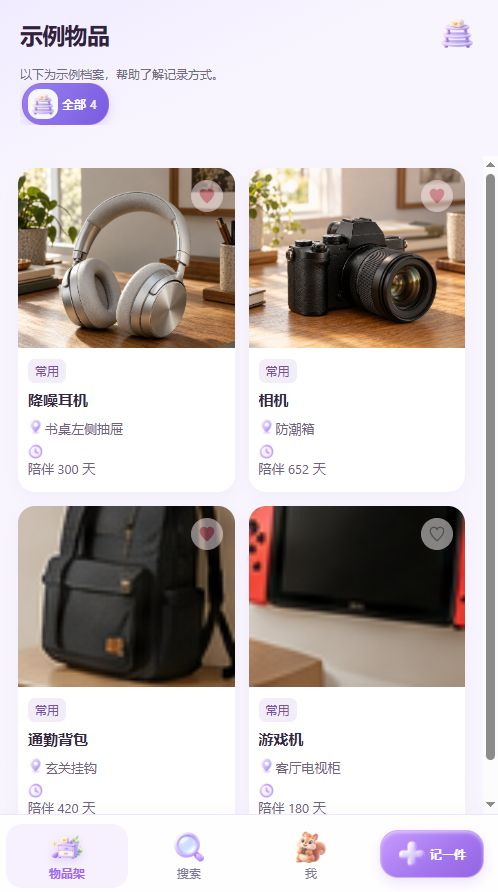
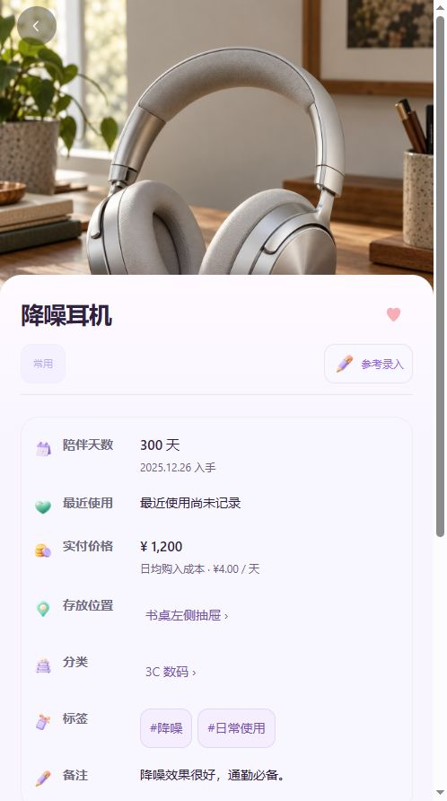
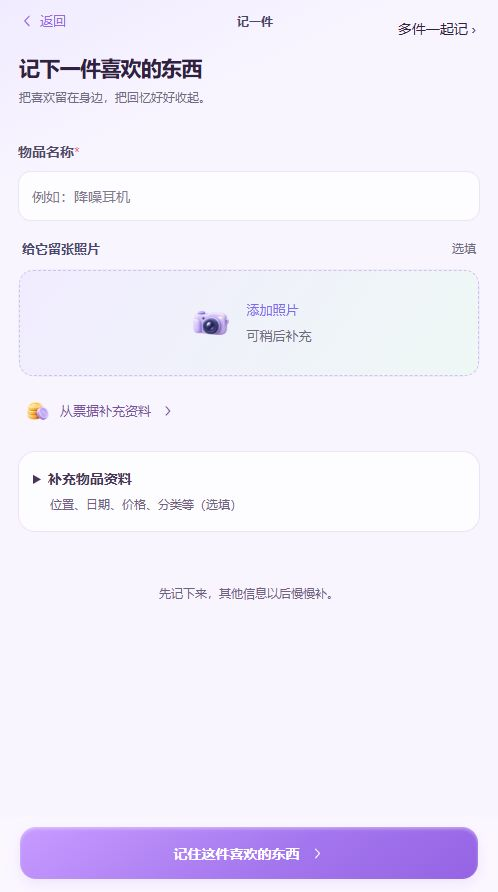

<p align="center"></p>

# 囤囤鼠 · Stash

收藏生活里，每一份喜欢。

一个在本机记录物品、收藏喜欢、查找存放位置的 Android 应用。为耳机、背包、相机，也为那些舍不得忘记的小东西，留下一份自己的档案。

[English](README.en.md) · [下载安装包](../../releases) · [使用指南](docs/USER_GUIDE.md) · [隐私说明](docs/PRIVACY.md)

## 页面预览

以下为当前网页构建的实际界面截图，物品来自内置示例，不是用户档案。手机上的系统状态栏、字体和布局可能略有不同。

<p>  </p>

## 下载与安装

当前公开内测版本：**0.4.4-pro-preview**，支持 **Android 8.0 及以上**，安装包约 **41.8 MB**。同一 APK 支持简体中文和 English，可在“我 → 界面语言”切换。

前往本仓库的 **Releases**，下载 `tuntunshu-0.4.4-pro-preview.apk`。下载列表里的 Source code 压缩包不是安装包。首次安装时，按系统提示允许当前浏览器或文件管理器安装此 APK；不需要关闭系统安全防护。

升级前先在应用内导出备份，再直接覆盖安装，**不要先卸载旧版**。卸载或清除应用数据会删除本机档案。

SHA-256 校验值：

```text
b496b27412ead83e4bb7c0e7a814a460afb3ead9ac3c2ce4dbe7f9664b80e7be
```

## 用它做什么

- **记录物品**：照片、名称、分类、位置、入手日期、价格、标签和备注；选填资料可以以后补。
- **留住喜欢**：收藏喜欢的物品，记录常用、想重新用、准备处理与已离手的状态。
- **找回东西**：按名称、位置或标签搜索，结合分类与状态筛选。
- **整理一批物品**：长按多选、批量改状态或移动位置，右滑进入删除确认。
- **管理照片与草稿**：放大、切换、调整封面和顺序；未完成的单件记录可保留草稿继续。
- **自己保管资料**：导出含照片的完整备份，在恢复前查看内容和冲突处理方式。

基础记录、搜索、分类与位置管理、已有收纳标签扫描、完整备份与恢复均免费。没有注册账户、云订阅或广告。

## 专业版

同一个应用内激活，无需另装专业版 APK。

| 功能 | 使用场景 |
| --- | --- |
| 照片识物 | 在记录物品时，获取通用名称与分类建议，核对后填入 |
| 票据辅助录入 | 从票据中提取资料，核对后补到当前记录 |
| 收纳标签制作 | 为位置或收纳箱制作、保存、打印二维码标签 |
| 高级统计与整理清单 | 按金额、分类、年份查看物品，筛选并导出清单 |

当前价格 **人民币 ¥9.9，一次购买，仅限一台设备**。购买通过应用内说明联系作者，人工核实付款后通过邮件发送兑换码，**不是付款后即时自动解锁**。不自动续费，不包含云同步。

照片识物和票据识别在设备上处理，结果可能出错，需要自行核对；识物优先建议“耳机、背包、相机”等通用名称，不保证品牌型号识别，也不会从外观猜测价格或存放位置。基础数据不会因未购买专业版而被锁住。

详见 [专业版与购买说明](docs/PRO.md)。国内外使用同一 APK；暂未提供外币结算，无法使用现有付款方式时请先邮件联系，勿先向其他收款账户转账。

## 关于本仓库

本仓库用于介绍、下载安装包和收集反馈，**目前不提供应用源代码，不是开源项目**。第三方组件的许可见 [第三方说明](THIRD_PARTY_NOTICES.md)。

当前为公开内测版。电脑侧构建、回归与页面检查已通过；作者收到的本轮手机验收反馈为通过，这不代表已覆盖所有 Android 机型。请保留独立备份。[更新记录](CHANGELOG.md) · [已知限制](docs/USER_GUIDE.md#已知限制)

问题反馈可使用本仓库 Issues，或邮件联系 **zhiandzhi@gmail.com**。请附版本、机型、Android 版本和复现步骤；公开反馈前遮住个人照片、位置、票据、设备码、兑换码和订单号。购买与付款资料请通过邮件发送，不要放进公开 Issues。
